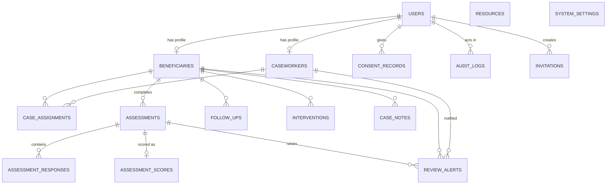

# Database design

Defined in `backend/app/models.py`; migration `backend/alembic/versions/0001_initial_schema.py` (autogenerated from the models and applied by
`alembic upgrade head`). SQLite by default; no SQLite-specific column types are used, so the same schema targets PostgreSQL
(foreign keys are enabled explicitly for SQLite via `PRAGMA foreign_keys=ON`). **Verified on PostgreSQL 16.2** (embedded server via `pgserver`): `alembic upgrade head`, `alembic check` (no drift), the seed, all 48 pytest tests and the 247-check live API audit all pass.

## ER diagram

## Tables
| Table | Purpose / notable columns | Constraints & indexes |
|---|---|---|
| `users` | username, display_name (pseudonymous), bcrypt `password_hash`, role, `token_version`, lockout fields, `is_synthetic` | unique username; CHECK role ∈ {beneficiary,caseworker,admin} |
| `beneficiaries` | pseudonymous `code`, org_unit, **coarse** age_band, language, case_status, `deletion_requested_at` | unique user_id & code; CHECK case_status; index (org_unit, case_status) |
| `caseworkers` | org_unit | unique user_id |
| `case_assignments` | beneficiary ↔ caseworker history; `active`, assigned_at/ended_at | index (beneficiary_id, active) |
| `assessments` | status draft/submitted, questionnaire_version, consent_confirmed, timestamps | CHECK status; index (beneficiary_id, submitted_at) |
| `assessment_responses` | question_id, value_int, optional value_text | unique (assessment_id, question_id) |
| `assessment_scores` | priority_level, overall_score, dimension_scores, **factors (explanation)**, change_summary, data_quality, engine_version, config_snapshot, ml_result, review_status | unique assessment_id; CHECK level |
| `review_alerts` | level, reason, status open/acknowledged/resolved, caseworker | CHECK level; index (caseworker_id, status) |
| `follow_ups` | status requested/scheduled/completed/cancelled, scheduled_for, requested_by_beneficiary, outcome_notes | CHECK status; index (caseworker_id, status, scheduled_for) |
| `interventions` | type, description, outcome, occurred_at | CHECK outcome |
| `case_notes` | free-text caseworker note | index beneficiary_id |
| `resources` | education / support / emergency content; `is_verified`, `is_active` | CHECK category |
| `consent_records` | append-only consent history | CHECK consent_type |
| `audit_logs` | actor, action, entity, short detail (never answers/secrets) | index action, created_at |
| `invitations` | **hash** of one-time onboarding code, expiry, used_at | unique code_hash |
| `system_settings` | key/value JSON (engine configuration) | PK key |

## Normalisation and design notes
* Answers are rows in `assessment_responses` (not a JSON blob) so questions can be analysed and purged individually.
* Scores/explanations are stored per assessment with the **config snapshot and engine version** used, so every historical recommendation is reproducible.
* Dimension scores / factors use JSON columns deliberately: they are derived, engine-versioned artefacts rather than relational facts.
* Identifiable data is minimal: no names, addresses or phone numbers; `display_name` can be a nickname; age is a band. Analytics never join to `users`.
* Every entity table has `created_at`; synthetic rows have `is_synthetic = true`.

## Retention and deletion
* **Erasure** (`DELETE /admin/beneficiaries/{id}`): ORM cascades delete assignments → assessments → responses/scores; DB-level `ON DELETE CASCADE` removes notes, follow-ups, interventions, alerts; the user row (and thus consents) is removed; audit rows keep only the pseudonymous code with `actor` set NULL where the actor is gone.
* **Retention job** (`POST /admin/retention/run`): free-text answers older than `RETENTION_FREE_TEXT_DAYS` are nulled; scored data is retained for monitoring.
* Beneficiaries can request deletion (`POST /me/deletion-request`), which flags the record and withdraws analytics consent immediately.
