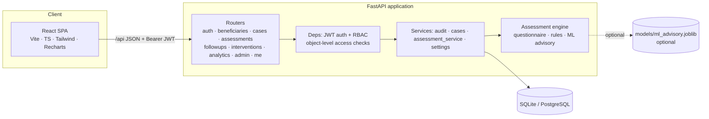
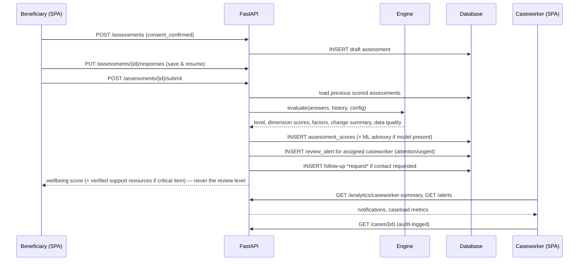
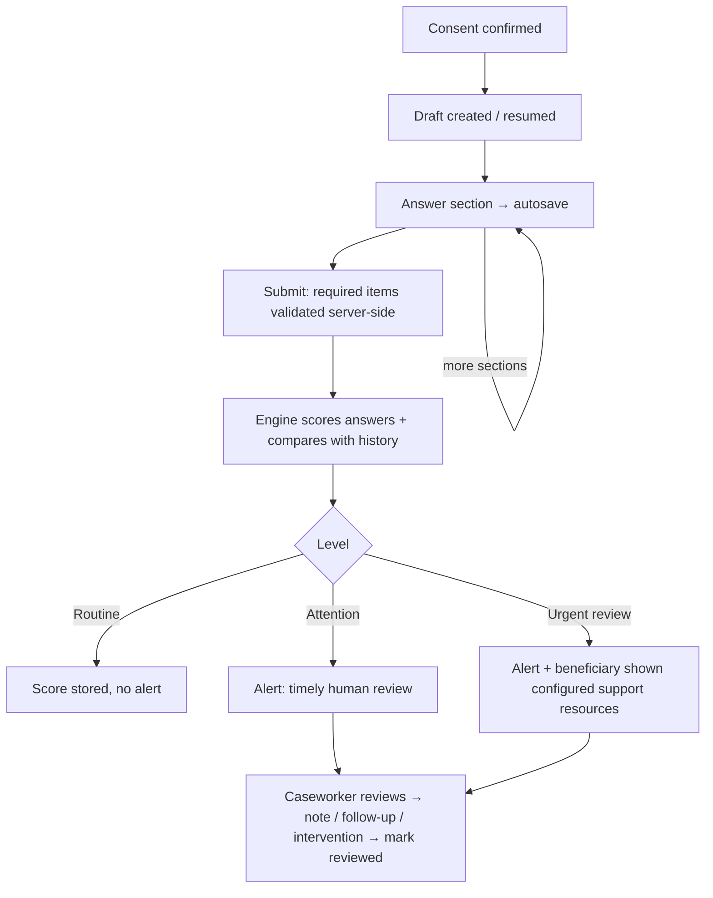

# System architecture

## 1. Context and goals
SAATHI is a decision-support prototype (SIH26094). Authorised people review explainable, rule-derived *review priorities*; the system never diagnoses
and never acts on a person automatically (no external messages, no punitive actions).

## 2. Component diagram

## 3. Layers and responsibilities
| Layer | Location | Responsibility |
|---|---|---|
| Presentation | `frontend/src` | Role-specific pages; **no business rules, no mock data** — everything via `/api` |
| API | `backend/app/routers` | HTTP contract, validation (Pydantic), status codes |
| Authorisation | `backend/app/deps.py` | `require_roles()` (role) and `authorize_beneficiary_access()` (object-level: own record / assigned caseworker) |
| Domain services | `backend/app/services` | Audit logging, read models, glue between DB and engine |
| Assessment engine | `backend/app/engine` | **Pure functions**, no DB/network. Replaceable without touching the rest |
| Persistence | `models.py`, `alembic/` | Normalised schema, constraints, migrations |

## 4. Data flow (check-in → notification)

## 5. Assessment workflow

## 6. Key design decisions
| Decision | Rationale |
|---|---|
| Rule-based engine is primary, ML is advisory only | Transparent, auditable, no unvalidated model controlling outcomes; app works with no model file |
| Engine is a pure module (`app/engine`) | Unit-testable; upgradeable (e.g. a clinically validated instrument) without rewriting the app |
| Beneficiaries never see review level | Avoids labelling; they see a well-being score (100 − concern index) and resources |
| Admins have **no** access to assessments/cases | Least privilege; admin analytics are aggregate-only |
| Non-assigned caseworker gets 404 (not 403) | Does not reveal that a case exists |
| JWT with `token_version` | Logout / password change / deactivation invalidate tokens server-side |
| Alerts are in-app only | Spec forbids messaging third parties; nothing leaves the system |
| `UTCDateTime` type | Consistent tz-aware UTC across SQLite and PostgreSQL |
| Python-side aggregation for case lists | Simple and correct for a prototype; see limitations |
